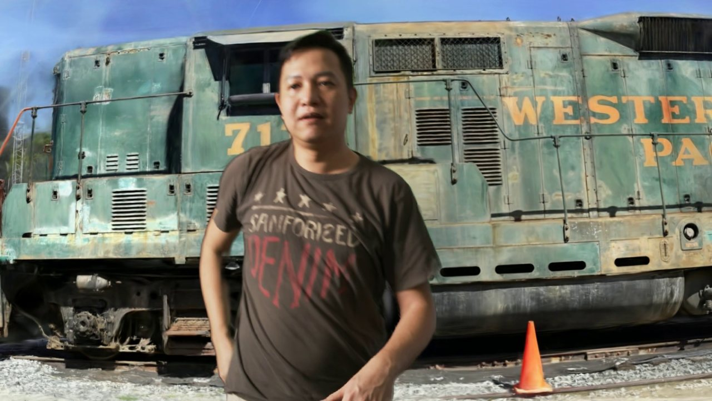
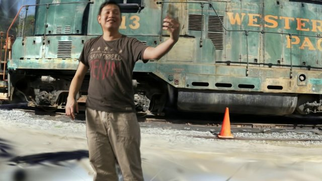
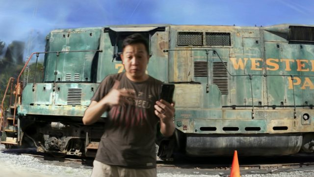
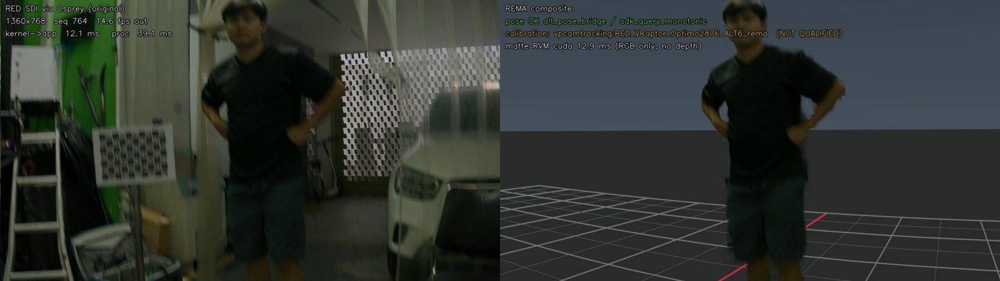
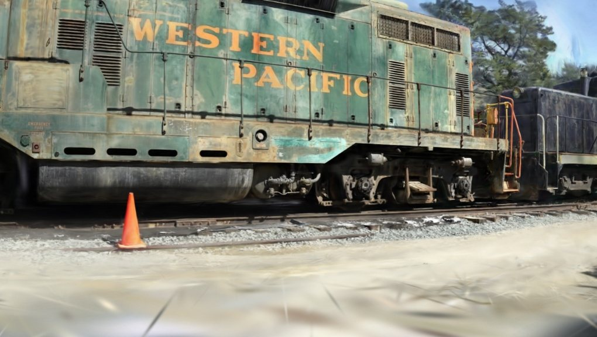
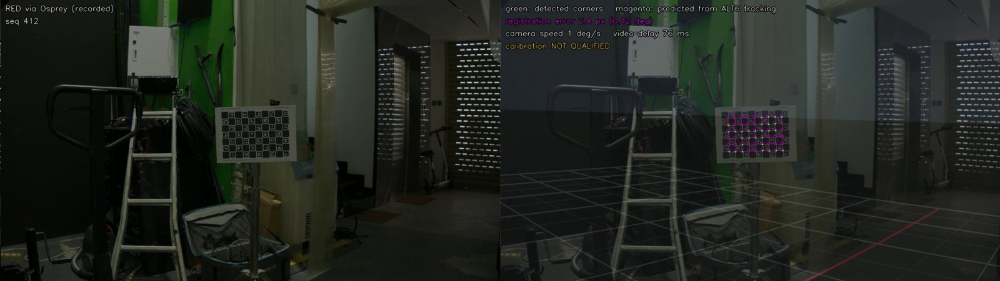
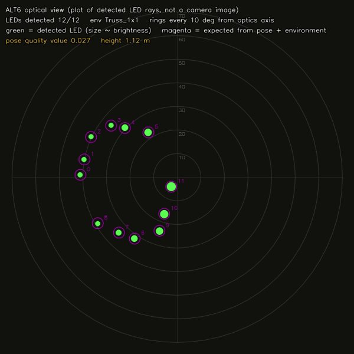

# REMA — Real-time Environment Matting and Anchoring

**Virtual production without an LED volume.** REMA takes the live picture from a cinema camera, cuts the actor out in real time, and places them inside a tracked 3D world — a photoreal 3D Gaussian Splatting (3DGS) scene that stays locked to the room while the camera moves. No LED wall, no green screen.



*Live REMA composite recorded with the operator view (`Take2`): RED V-RAPTOR picture via SDI, actor matte on the GPU, background rendered from the Antilatency-tracked camera pose. The real room (a cluttered workshop) is fully replaced.*

| | |
|---|---|
|  |  |

*Different camera positions from handheld takes: the scene keeps its perspective, horizon and scale as the tracked camera moves.*

---

## How it works



*Left: the real camera frame (workshop, car, ladders). Right: REMA output — actor kept, room replaced by a metric floor grid anchored in the tracked world.*

For every camera frame, REMA:

1. **Captures** the RED V-RAPTOR 8K VV picture through an Osprey SDI→USB bridge (V4L2, kernel timestamps and sequence numbers kept).
2. **Looks up the camera pose at that frame's time** from the Antilatency Alt mounted on the camera (250 Hz pose stream, interpolated to the frame time with a measured 80 ms video delay).
3. **Renders the virtual background** from that exact pose and the calibrated lens (intrinsics + distortion): a 1-million-splat 3DGS scene in ~11–17 ms with a custom OpenGL renderer, or the metric calibration grid.
4. **Mattes the actor** with Robust Video Matting on the RTX GPU (~9–13 ms).
5. **Composites** the actor's original pixels over the background and shows it fullscreen; **R** records takes to H.265.

```
 RED V-RAPTOR ──SDI──▶ Osprey ──USB──▶ capture (V4L2, seq + timestamps) ─┐
                                                                         ├─▶ RVM matte (GPU) ─┐
 Antilatency Alt on camera ──radio──▶ 250 Hz pose bridge ──▶ pose @ frame time                ├─▶ composite ─▶ operator view / H.265 take
                                     lens + Alt→camera calibration ─▶ 3DGS / grid render (GPU)┘
 Astra Pro (depth) ─▶ live depth picture-in-picture (depth-assisted matting: next step)
```

<table><tr>
<td width="50%"><br><em>The 3DGS background rendered from the real tracked camera pose through the calibrated lens model.</em></td>
<td width="50%"><br><em>Registration test: board corners predicted from tracking alone (magenta) vs. detected (green) while the camera moves.</em></td>
</tr></table>



**Tracking you can see.** REMA can record what the Antilatency Alt actually sees — the direction of every ceiling LED it detects, 84 times a second — and overlay where the tracking environment says they should be. On this rig all 12 LEDs match the environment model to 0.11°.

<br clear="right">

## What has been measured so far

Prototype numbers on the current rig (RED V-RAPTOR 8K VV + Canon 24-50, Osprey VB-USL at 1360×768, Antilatency Alt on the top handle, RTX 5070). None of this is a qualified production result yet — see [docs/PROJECT_OUTLINE.md](docs/PROJECT_OUTLINE.md).

| Item | Result |
|---|---|
| Lens calibration (34 views, every 4th held out) | 0.34 px median, 0.68 px max reprojection on held-out views |
| Alt → camera (nodal) calibration | 17.3 cm offset; held-out board pose error 7.7 mm / 0.21° (max 0.25°) |
| Rigidity check (camera vs. Alt rotation, 78 pairs) | 0.06° median disagreement |
| Moving-camera registration (board 2 m, slow motion) | ~3 px median (0.13–0.15°), 95% within ~7 px |
| Video vs. tracking delay | 76–80 ms (motion cross-correlation + registration sweep) |
| 3DGS background, 1.03 M splats, 1360×768 + lens distortion | 11 ms (offline), 16–17 ms in the live pipeline |
| Actor matte (RVM, RTX 5070) | 9–13 ms |
| Live operator view | ~11–14 fps (limited by the Osprey's ~14.8 fps USB output) |

Known limits right now: the Osprey VB-USL delivers only 1360×768 at ~14.8 fps over USB; matting is colour-only (bright background details can fringe at the edges); fast motion is not yet covered by the registration test; the Antilatency socket must sit on a properly powered USB port (see the operator guide).

## Quick start (rig host)


**Desktop app:** `tools/install_desktop_app.sh` adds **REMA Live** to the GNOME Dash. One click runs pre-flight checks (Osprey signal, tracking socket, Astra) and opens the fullscreen operator view; problems are reported as desktop notifications.

<br clear="left">

The rig host setup (drivers, udev rules, Python environments) is in [RIG_HOST.md](RIG_HOST.md). Manual start with everything connected:

```bash
cd ~/Desktop/REMA
~/rema-data/envs/live-gpu/bin/python tools/gpu_session.py --seconds 3600 -- \
  ~/rema-data/envs/live-gpu/bin/python tools/rig_live.py --pose bridge \
  --profile ~/rema-data/calibration/rig/RED_VRaptor_Optimo2876_ALT6_rema.json \
  --matte cuda --background splat --view composite
```

| Key | Operator view |
|---|---|
| **R** | start / stop a take → `~/Desktop/Take<N>_<date_time>.mp4` (H.265, clean composite); a red circle shows top left while recording, and a glass notification in the centre confirms the saved file name for 3 s |
| **I** | hide / show text and tracking bar (camera + depth picture-in-pictures, the recording circle and the saved-clip notification stay) |
| **V** | composite ↔ overlay (virtual scene blended over the real room, for registration checks) |
| **F** / **Esc** | fullscreen on / off |
| **Q** | quit |

The tracking bar at the bottom is long and green when tracking is good and shrinks to red on dropouts, inertial-only tracking or jitter. If tracking drops mid-take, REMA keeps compositing over the last good pose (flagged on screen and in the take metadata) instead of cutting to the raw camera.

## Calibration workflow

1. **Lens** — ChArUco views of the board (VPcamtracking calibration UI or REMA tools), solved with held-out views.
2. **Alt → camera offset** — `tools/rig_record.py`: on-screen countdown, board fixed, camera moved between holds; records RED, Alt and Astra together and solves automatically (`tools/rig_nodal_offline.py`).
3. **Registration test** — `tools/rig_registration.py`: move the camera, REMA predicts the board from tracking every frame and reports error by camera speed plus the best video delay.

Step-by-step instructions: [docs/OPERATOR_GUIDE.md](docs/OPERATOR_GUIDE.md).

## Repository layout

| Path | What it is |
|---|---|
| `rema/sdi_capture.py` | V4L2 capture for the Osprey (sequence numbers, kernel timestamps, no-signal detection, device lookup by name) |
| `rema/pose.py` | Antilatency pose samples, history + interpolation to frame time, frame conventions, tracking-quality score |
| `rema/nodal.py` | Alt→camera hand-eye solver (rotation-first + pixel refinement, held-out evaluation) |
| `rema/splat.py` | 3DGS loader (.ply / .splat), scene alignment, OpenGL EWA splat renderer with lens distortion |
| `rema/virtual_scene.py` | metric grid + blocks renderer, compositing |
| `rema/astra_depth.py` | live Astra Pro depth stream (separate helper process, auto-reconnect) |
| `rema/video_out.py` | H.264 review videos, H.265 take recorder |
| `tools/rig_live.py` | live engine + fullscreen operator view |
| `tools/rig_record.py`, `tools/rig_nodal_offline.py`, `tools/rig_registration.py` | calibration recording, nodal solve, registration test |
| `tools/alt_pose_bridge.cpp`, `tools/alt_rays_bridge.cpp`, `tools/alt_view.py` | Antilatency SDK bridges: 250 Hz pose, raw LED rays |
| `tests/` | 150 unit tests (synthetic data; GPU tests skip without OpenGL 4.3) |
| `calibration_targets/` | printable ChArUco boards |

Earlier work (Orbbec-only prototype, guided depth calibration, room tracking) remains in `rema/` and `tools/` and is documented in [WORKLOG.md](WORKLOG.md).

## Documents

- [docs/OPERATOR_GUIDE.md](docs/OPERATOR_GUIDE.md) — running a shoot: rig check, calibration, live view, takes, troubleshooting.
- [docs/PROJECT_OUTLINE.md](docs/PROJECT_OUTLINE.md) — architecture, conventions, phases and current status.
- [RIG_HOST.md](RIG_HOST.md) — hardware inventory and one-time host setup.
- [PLAN_REMA.md](PLAN_REMA.md) — original research plan and decisions.
- [WORKLOG.md](WORKLOG.md) / [PROJECT_STATE.json](PROJECT_STATE.json) — dated engineering log with reproduction commands and measured evidence.

## Licence

REMA's source code, documentation and images are released under the [MIT License](LICENSE).

Third-party components are **not** included in this repository and remain under their own licences: Antilatency SDK and Service (proprietary, via the separate VPcamtracking bundle), Robust Video Matting model (downloaded at setup, hash in `RUNTIME_ASSETS.json`), OpenNI2 / Orbbec drivers, and the sample 3DGS scene (Inria pre-trained Tanks & Temples "train", research use only).
